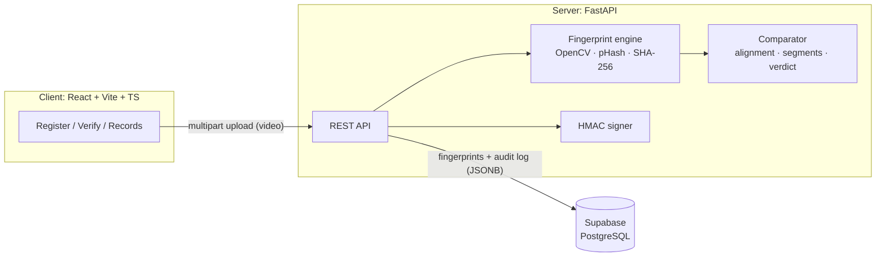

# Dashcam Video-Fingerprint System

**A client–server system that lets an insurer fingerprint dashcam footage when a claim is opened, and later prove whether a submitted copy is the same footage, a harmless re-encode, or an edited video — down to the exact seconds that were changed.**

Cloud Computing project · **FastAPI** · **React + Vite + TypeScript** · **Supabase (PostgreSQL)** · Docker · GitHub Actions

---

## The problem

Dashcam videos are key evidence in motor-insurance claims, but they travel through many hands: the policyholder's phone, messaging apps, garages, lawyers. Each step can re-compress the file, and a dishonest party can cut or replace a few seconds. A plain file hash (SHA-256) can't tell the difference: **any** re-encode changes it, so honest copies fail too.

## The approach

Each video gets a **two-layer fingerprint**:

| Layer | What | Survives re-encoding? | Detects edits? |
|---|---|---|---|
| Cryptographic | SHA-256 of the exact bytes | ❌ | ✅ (but can't say where) |
| Perceptual | 64-bit DCT **pHash** of one frame every 0.5 s | ✅ (codec, bitrate, resolution) | ✅ **and locates them** |

Verification aligns the submitted video's hash sequence with the original's (searching small time offsets, so trimmed clips are handled) and compares each sample by Hamming distance:

| Verdict | Meaning |
|---|---|
| `AUTHENTIC_EXACT` | Byte-for-byte identical file |
| `AUTHENTIC_REENCODED` | Same footage, re-exported / compressed / resized |
| `TAMPERED` | Matches the original but segments were **altered**, **missing** or **extra**, each reported with start and end times |
| `NO_MATCH` | Different footage |

Every stored record is also **HMAC-SHA256 signed** (claim data + hashes). If someone edits a row directly in the database, the signature check fails and the API flags the record as untrustworthy.

The video itself is **never stored**: it's streamed to a temp file, fingerprinted, then deleted. That keeps storage small and personal data out of the database.

## Architecture



```
backend/
  app/fingerprint/engine.py    frame sampling, pHash, SHA-256
  app/fingerprint/compare.py   alignment, Hamming distances, segments, verdicts
  app/routers/                 /fingerprints, /verify, /verifications, /stats
  app/signing.py               HMAC record signatures
  scripts/make_sample_videos.py  synthetic original / re-encoded / tampered / trimmed clips
  tests/                       engine + API tests (SQLite and PostgreSQL)
frontend/src/
  pages/                       Dashboard, Register, Verify, Records, RecordDetail
  components/Timeline.tsx      frame-by-frame match timeline + hash "barcode"
supabase/migrations/           schema (RLS enabled, JSONB, indexes)
```

## API

Interactive docs at `http://localhost:8000/docs` when the backend is running.

| Method | Path | Description |
|---|---|---|
| `POST` | `/api/fingerprints` | Upload an original (`file`, `claim_reference`, optional `policy_number`, `vehicle_plate`, `notes`) → signed fingerprint |
| `GET` | `/api/fingerprints?q=` | Search/paginate records |
| `GET` | `/api/fingerprints/{id}` | Record with frame hashes + signature check |
| `DELETE` | `/api/fingerprints/{id}` | Remove a record |
| `POST` | `/api/verify` | Upload a copy; compare against a `fingerprint_id`, a `claim_reference`, or all records |
| `GET` | `/api/verifications` | Verification audit log |
| `GET` | `/api/stats` | Dashboard totals |
| `GET` | `/api/health` | Liveness (always public) |

Set `API_KEY` on the server to require an `X-API-Key` header on every route except health.

## Run it locally

**Requirements:** Python 3.11+ and Node 20+ (or just Docker).

### Option A: two terminals (SQLite, zero setup)

```bash
# Backend
cd backend
python -m venv .venv
.venv\Scripts\activate          # macOS/Linux: source .venv/bin/activate
pip install -r requirements-dev.txt
uvicorn app.main:app --reload   # http://localhost:8000/docs

# Frontend (second terminal)
cd frontend
npm install
npm run dev                     # http://localhost:5173 (proxies /api to :8000)
```

Generate demo clips to try every verdict:

```bash
cd backend
python scripts/make_sample_videos.py ../sample_videos
```

Register `original.mp4`, then verify `reencoded.avi` (authentic), `tampered.mp4` (seconds 5–7 flagged), `trimmed.mp4` (first 2 s missing) and `unrelated.mp4` (no match).

### Option B: Docker Compose (PostgreSQL with the Supabase schema)

```bash
docker compose up --build       # UI: http://localhost:8080 · API: http://localhost:8000/docs
```

## Deploying with Supabase

1. Create a Supabase project.
2. Apply the schema: **SQL Editor** → paste `supabase/migrations/20261123000000_init.sql` → Run (or `supabase db push`).
3. Copy the connection string from **Project Settings → Database → Connection string (URI)** (session pooler) into the backend's `DATABASE_URL`.
4. Set a strong `SIGNING_SECRET` (`python -c "import secrets; print(secrets.token_hex(32))"`) and, optionally, `API_KEY`.
5. Deploy `backend/` (any container host: Render, Fly.io, Cloud Run, Azure Container Apps) and `frontend/` (static hosting, or the nginx image).

Row Level Security is enabled with no policies, so Supabase's public `anon` key can't read the tables. Only the backend, which holds the database credentials, can.

## Tests

```bash
cd backend && pytest            # 23 tests: pHash robustness, every verdict, API, signature tampering, auth
cd frontend && npm test && npm run build
```

CI runs the backend suite on **SQLite and PostgreSQL** (with the Supabase migration applied), plus ruff, the frontend tests and the type-checked production build.

## Design notes and limits

- **Sampling every 0.5 s** keeps a 1-minute clip to 120 hashes (~2 KB of JSONB). Edits shorter than one interval can slip between samples; lower `SAMPLE_INTERVAL_S` for stricter checks.
- **Hamming threshold 10/64** separates re-encoding noise (typically 0–6 bits) from new content (typically 20+ bits).
- **Alignment** searches ±6 samples (±3 s), which covers trimmed starts. Speed changes and frame-rate conversion that alter timing are out of scope.
- Large uploads are streamed to disk in 1 MB chunks with a configurable size limit (`MAX_UPLOAD_MB`).
